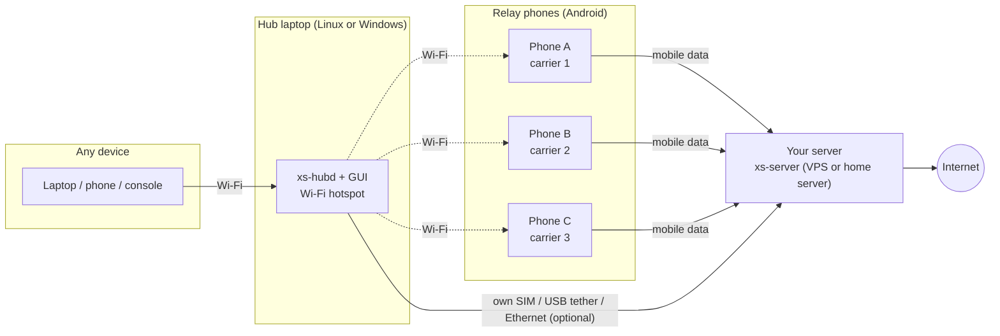

# CrossStream

**Bond the mobile data of several Android phones into one fast, stable connection —
self-hosted, end-to-end encrypted, shared as a Wi-Fi hotspot.**

*"Don't cross the streams." Here we do, on purpose.*

[](https://github.com/zyndata/cross-stream/releases/latest)
[](LICENSE)


> **Status:** beta — latest release `v0.10.0`. The field test (real carriers, a day
> away from home) is still in progress; `v1.0.0` follows it. Everything below works and is
> tested in the Docker test environment, and most of it on real phones and laptops —
> see [Status and limitations](#status-and-limitations) for what is not yet tried on hardware.

---

## Contents

- [What it does](#what-it-does)
- [How it works](#how-it-works)
- [Download](#download)
- [What you need](#what-you-need)
- [Quick start](#quick-start)
- [Install: server](#install-server)
- [Install: hub](#install-hub)
- [Install: relay app (Android)](#install-relay-app-android)
- [Everyday use](#everyday-use)
- [Updates](#updates)
- [Security and privacy](#security-and-privacy)
- [Mobile data, carriers and battery](#mobile-data-carriers-and-battery)
- [Status and limitations](#status-and-limitations)
- [Troubleshooting](#troubleshooting)
- [Build from source](#build-from-source)
- [Changelog](#changelog)
- [License](#license)

## What it does

In places with weak mobile coverage one phone gives a few Mb/s. A few phones — yours and
your friends', on different carriers — give a multiple of that, if their links work as one.
CrossStream does exactly that:

- **Friends' phones relay, they don't tether.** Each phone runs a small app with one on/off
  switch. It joins the hub's Wi-Fi and forwards encrypted packets over its mobile data.
  Friends can't read the traffic, and they decide how much data, battery and priority they give.
- **A laptop is the hub.** It bonds all phones (plus its own SIM modem, USB-tethered phone or
  Ethernet, if any) into one encrypted tunnel and shares it as a **Wi-Fi hotspot**. Any
  device joins that hotspot — nothing to install on it.
- **Your own server** puts the streams back together and sends the traffic to the internet.
  Any Linux machine with Docker works — a small VPS or a home server. If you already run
  Home Assistant, it can also be installed there as an app.

Highlights:

| | |
|---|---|
| **Real bonding** | One download or upload uses every phone at once (per-path congestion control, reordering, fast re-send). |
| **Failover under 1 s** | A phone that drops is replaced by the others; lost packets are re-sent, transfers don't stall. |
| **Two modes** | *Max throughput* for downloads, *min latency* for games, calls and VR (redundant sending, no long holds). |
| **TCP accelerator** | Split-TCP proxy (on by default): in home tests 72 Mb/s instead of 27 Mb/s over the same two links. |
| **Works when the server is down** | DIRECT fallback: each connection leaves through one phone; back to bonding automatically. |
| **Carrier blocks UDP?** | Relays fall back to TCP or WebSocket-over-TLS by themselves; a TCP link uses 2 connections (4 while it loses packets), so it keeps its speed under loss. |
| **Per-link control** | Priority (normal / secondary / backup), up/down direction, rate limit, data cap per session/day/month. |
| **Extras** | Bypass list (domains that should leave through a phone's own IP), port forwarding, built-in speed test, usage history per friend, desktop notifications, web admin panel. |

## How it works



The phones join the hub's hotspot over Wi-Fi and forward the hub's encrypted packets over
their mobile data. The tunnel is encrypted between the **hub and the server**
(Noise `IK` + ChaCha20-Poly1305); the relays only see ciphertext. Details:
[architecture](docs/architecture.md), [protocol](docs/protocol.md).

| Part | Program | Runs on |
|---|---|---|
| Server | `xs-server`, admin CLI `xs-ctl`, web panel | Linux with Docker (VPS or home server); optionally a Home Assistant app (amd64 / aarch64) |
| Hub | `xs-hubd` (service), `xs-hubctl` (CLI), `xs-hub-gui` (desktop app) | Linux laptop (amd64; arm64 without GUI), Windows 11 laptop (Windows 10: built, untested) |
| Relay | CrossStream relay app | Android 10 or newer |

## Download

**[⬇ Latest release](https://github.com/zyndata/cross-stream/releases/latest)** — all
files of a release are on that page (`vX.Y.Z` below is the version you download):

| You want | File |
|---|---|
| Relay app for Android | `crossstream-relay-vX.Y.Z.apk` |
| Hub for a Linux laptop (x86-64, with desktop app) | `crossstream-hub-vX.Y.Z-linux-amd64.tar.gz` |
| Hub for Linux ARM64 (e.g. Raspberry Pi; CLI only) | `crossstream-hub-vX.Y.Z-linux-arm64.tar.gz` |
| Hub for Windows (with desktop app) | `crossstream-hub-vX.Y.Z-windows-amd64.zip` |
| Server as a Docker image (amd64) | `xs-server-image-vX.Y.Z-amd64.tar.gz` |
| Server as a Home Assistant app (local install) | `crossstream-ha-app-vX.Y.Z.tar.gz` |
| Checksums | `SHA256SUMS` and one `.sha256` file per download |

Check a download before installing it:

```sh
sha256sum -c crossstream-hub-vX.Y.Z-linux-amd64.tar.gz.sha256      # Linux
```
```powershell
Get-FileHash .\crossstream-hub-vX.Y.Z-windows-amd64.zip             # Windows: compare with the .sha256 file
```

Once installed, the relay app, the hub app and `xs-hubctl update` find new releases
themselves — see [Updates](#updates).

## What you need

| | Requirement |
|---|---|
| **Server** | A machine reachable from the internet on **UDP 51900** (and TCP 51900 for carriers that block UDP; [another port](#tunnel-port) works too): a home server behind your router's port forwarding, or a VPS. No static IP needed — see the note below. |
| **Hub (Linux)** | A laptop with NetworkManager, `iw`, `nft`, systemd and a Wi-Fi card that supports access-point mode (most do). Tested on Ubuntu. The desktop app needs GTK 3 and WebKitGTK 4.1 (Ubuntu 22.04+). |
| **Hub (Windows)** | Windows 11 with a Wi-Fi adapter that offers *Mobile hotspot* (Settings → Network & internet). Windows 10 support is built but not yet tested on hardware. |
| **Relays** | Android 10+ phones with mobile data, within Wi-Fi range of the hub. One phone = one mobile link (a dual-SIM phone uses one data SIM at a time). |
| **Clients** | Anything with Wi-Fi. Nothing to install. |

> **No static IP? No problem.** A typical home connection whose address changes from time to
> time works fine: give the server a dynamic DNS name (many routers have a free one built in,
> or use any DDNS service) and put that name in the server's *Public endpoints*. Hubs look the
> name up each time they connect. What does *not* work is carrier-grade NAT, where your router
> has no address of its own on the internet: if the WAN address shown by your router differs
> from what [ifconfig.me](https://ifconfig.me) shows (or starts with `100.64`–`100.127`), port
> forwarding can't reach you — use a small VPS instead.

Gains are best when the phones are on **different carriers or cells** — phones on the same
tower share its capacity. Bonded download speed is also capped by the **server's upload**
speed (a home server on 600/100 fibre gives at most ~100 Mb/s).

## Quick start

1. **Server** — install it with [Docker](#docker-on-linux) on a VPS or a home Linux server
   (or as a [Home Assistant app](#home-assistant-app-optional)), forward UDP + TCP 51900 on your router (or pick
   [another port](#tunnel-port) now), and set the address hubs should use — best a dynamic
   DNS name, so a changing home IP doesn't matter.
2. **Hub** — install it on the laptop ([Linux](#linux) / [Windows](#windows)) and start it:
   the laptop's Wi-Fi becomes the CrossStream hotspot.
3. **Pair the phones** — the hub app shows a QR code; each friend installs the
   [relay app](#install-relay-app-android), taps **Add hub**, scans the code and flips the switch.
4. **Enroll the hub** — on the server create a one-time code (web panel → *Huby* → *Dodaj hub*,
   or `xs-ctl enroll <name>`), paste it into the hub app (or `xs-hubctl enroll <code>`).
   On first start the hub app walks you through it: pair a phone first, then paste the code;
   the hub reaches the server through the phone. Without a phone it uses a local link or the
   laptop's own internet — that fails when the server is in the same home network behind a
   router without hairpin NAT.
   A code for another server (hub app → *Ustawienia* → *Zarejestruj ponownie*) replaces the
   current server. If the new server does not answer at once, the hub still switches to it and
   keeps trying through the phones until it does (banner "Czekam na odpowiedź nowego serwera").
5. **Connect** — join the hotspot from any device. The hub app shows the mode
   (bonded / direct / offline), every phone's speed, signal and data used.

## Install: server

The server is one Docker container. Run it on a Linux machine you control — a small VPS or
a home server — or, if you already have Home Assistant, as a Home Assistant app. Both run the
same server with the same web panel and admin CLI.

### Docker on Linux

Docker Engine with the compose plugin, host networking. From a checkout of this repository:

```sh
cd deploy/server
echo "XS_SERVER_PUBLIC_ENDPOINTS=vpn.example.org" > .env      # your (dynamic) DNS name or public IP
# from a release: docker load -i xs-server-image-vX.Y.Z-amd64.tar.gz && echo "XS_IMAGE_TAG=vX.Y.Z" >> .env
# or build it here: docker compose build
alias xsc='docker compose -f docker-compose.yml -f docker-compose.host.yml'
xsc up -d
xsc exec server xs-ctl enroll my-laptop                       # one-time hub code (24 h)
```

Before the first start read the host setup in [deploy/server/README.md](deploy/server/README.md)
(Docker's `FORWARD` policy, sysctls, firewall, backups of `data/`, SSH deploy with automatic
rollback). Admin commands: `xs-ctl list | sessions -watch | revoke | rename | info | audit |
tunnel-port | restart`.
The web panel listens on `https://localhost:8443` only (`xs-ctl admin add <user>`, optional
TOTP); reach it from elsewhere through `ssh -N -L 8443:localhost:8443 <server>`.

### Home Assistant app (optional)

An alternative for a home server that already runs Home Assistant OS or Supervised
(amd64 or aarch64).

1. Settings → Apps → App store → ⋮ → **Repositories** → add
   `https://github.com/zyndata/cross-stream`.
2. Install **CrossStream Server**, set **Public endpoints** (your dynamic DNS name or public IP),
   turn on *Start on boot* and *Watchdog*, start it.
3. Router: forward **UDP and TCP 51900** to the Home Assistant host.
4. Open **CrossStream** in the sidebar (no extra login; Home Assistant administrators only).

Updates come through Home Assistant's *Update* button. Full guide:
[ha/crossstream_server/DOCS.md](ha/crossstream_server/DOCS.md).
Without internet access from HA to GitHub, unpack `crossstream-ha-app-vX.Y.Z.tar.gz` into
`/addons/` and install it from *Local apps*.

### Tunnel port

Hubs connect to **port 51900** (UDP, and TCP as a fallback) unless you choose another one —
for example when 51900 is taken or a network blocks it. Best done **during the first setup**,
before any hub is enrolled. The port is kept in one place only, and every tool just shows
and changes it there:

| Server | Where the port lives | Change it with |
|---|---|---|
| Docker | `public_port` in `data/server.yaml` (or `XS_SERVER_PUBLIC_PORT`, then read-only) | the web panel (*Serwer* → *Port tunelu*), `xs-ctl tunnel-port 51901`, or the file |
| Home Assistant | the app's *Network* section (`51900/udp` and `51900/tcp`, same port) | that section, the web panel or `xs-ctl tunnel-port 51901` |

A new port applies after a **restart**: until then the web panel shows *Wymagany restart*
(restart required) on every page, with a button that restarts the server (`xs-ctl restart`
does the same). Forward the new port (UDP and TCP) on your router to the server. With Docker
the router must translate it to the server's 51900, or change the published ports
([details](deploy/server/README.md)).

> **Changing it after hubs are enrolled:** each hub keeps the port from its enrollment code and
> can no longer connect. The server log, `xs-ctl list` and the panel (*Huby*, "zarejestruj
> ponownie") name those hubs. Remove each one and enroll it again with a new code
> (`xs-ctl revoke <name>`, `xs-ctl enroll <name>`, paste the code in the hub). Relay phones need
> nothing: they follow their hub.

### Docker Desktop on Windows (testing only)

Works with the default `docker-compose.yml` (see
[deploy/server/README.md](deploy/server/README.md#windows-pc-with-docker-desktop)), but Docker
Desktop's user-space proxy limits forwarded traffic to a few Mb/s per connection. Use it to
try CrossStream out, not for real use.

## Install: hub

### Linux

```sh
sha256sum -c crossstream-hub-vX.Y.Z-linux-amd64.tar.gz.sha256
tar -xzf crossstream-hub-vX.Y.Z-linux-amd64.tar.gz
cd crossstream-hub-vX.Y.Z-linux-amd64
sudo sh install.sh                       # service, CLI, group "crossstream", polkit rule
sudo sh gui/install.sh bin/xs-hub-gui    # desktop app, menu entry "CrossStream Hub" (amd64 only)
sudo usermod -aG crossstream $USER       # once, then log out and in again
```

Start **CrossStream Hub** from the menu: it starts the hub service and asks on close whether
to keep it running. Without the desktop app: `sudo systemctl start xs-hubd`, then
`xs-hubctl hotspot` (name, password, channel) and `xs-hubctl pair-qr` (QR in the terminal).

If the laptop's Wi-Fi is connected to a network, the hub asks what to do: run the hotspot
next to it (cards that allow it) or disconnect. Everything the hub changes in the network
setup is removed again when it stops. Uninstall: `sudo sh install.sh --uninstall`.
More: [deploy/hub/README.md](deploy/hub/README.md).

### Windows

1. Unpack `crossstream-hub-vX.Y.Z-windows-amd64.zip`.
2. In that folder, from PowerShell **as administrator**:
   ```powershell
   powershell -ExecutionPolicy Bypass -File install.ps1
   ```
   It installs the service `CrossStreamHub`, `xs-hubctl`, the Wintun driver DLL, firewall
   rules and the local group `crossstream` (you are added to it).
3. Sign out and in once, then start **CrossStream Hub** from the Start menu.

The hotspot uses Windows' *Mobile hotspot* (subnet `192.168.137.0/24`). Don't change
*Share my Internet connection from* while the hub runs. Set *When I close the lid* to
*Do nothing* on AC power. Uninstall: `install.ps1 -Uninstall`. More:
[docs/setup-cases.md](docs/setup-cases.md#5-windows-hub-phase-16).

The Windows hub reacts to network changes at once (a phone plugged in for USB tethering shows
up within about a second) and runs at *above normal* process priority so forwarding keeps up
while the laptop is busy; add `-normal-priority` to the service command line to turn that off.

### Laptop's own links (optional)

Besides the relay phones, the hub can bond its own internet interfaces: a phone on USB
tethering (no app needed), Bluetooth PAN, Ethernet, a USB modem or the laptop's SIM. They
show up switched off under *Łącza lokalne* (local links) in the hub app, or
`xs-hubctl uplinks`. A USB-tethered Android phone must have its Wi-Fi off.

A link behind a login page (hotel, train, café Wi-Fi shared over USB) is detected when it
comes up or stops working: it shows *Wymaga logowania* and stays out of the bond until you
log in. *Zaloguj* in the hub app (or `xs-hubctl uplinks captive <link> -open`) opens the
login page in your browser through that link; the hub checks again every 30 s for 10 minutes.

## Install: relay app (Android)

1. Download `crossstream-relay-vX.Y.Z.apk` on the phone (or send it to friends).
2. Open it and allow *Install unknown apps* for your browser or file manager when Android asks.
   The app is not on Google Play.
3. Open **CrossStream**, allow notifications, tap **Add hub** and scan the QR code shown by
   the hub app. Allow Android's one-time Wi-Fi request for the hub's network.
4. Flip the big switch. The app joins the hub's Wi-Fi and starts relaying.

Settings a friend controls (the hub cannot override them): data limit per
session / day / month (stop or slow down when reached), battery threshold (default 20 %),
how this hub may use the phone (normal / only when needed / only as backup), start on boot.
The app remembers several hubs and connects by itself to the strongest one in range.
Pull the main screen down to refresh which hubs are in range right away (Android allows a few
Wi-Fi scans per two minutes; after that the last scan is shown).
App language: English or Polish.

## Everyday use

**Hub app** (Polish interface): QR for pairing, table of phones and local links (speed,
RTT / jitter / loss, data used, battery, signal hints), per-link priority / limits, mode and
redundancy, *Przyspieszanie TCP* (TCP accelerator), link speed test, 5-minute throughput chart,
hotspot settings, server enrollment, usage statistics (*Statystyki*), log export (with a
15-minute *Szczegółowe logi* switch), updates.

**Hub CLI** — everything the app does, scriptable:

```sh
xs-hubctl status                          # mode, tunnel, clients, relays (JSON)
xs-hubctl relays                          # paired phones and their state
xs-hubctl path "Anna S23" -priority backup -cap-mb 2000
xs-hubctl settings -mode min_latency      # or max_throughput; -redundancy off|auto|on; -pep on|off
xs-hubctl speedtest -all                  # raw capacity of each phone (uses their data!)
xs-hubctl bypass set netflix.com 203.0.113.0/24   # leave through a phone's own IP
xs-hubctl hotspot -ssid MyHotspot -psk "easy to type" -band a
xs-hubctl logs -o hub-log.txt             # redacted log, safe to share
xs-hubctl loglevel debug -for 15m         # more detail for a while, no restart
xs-hubctl uplinks captive u1 -open        # hotel/train login page of a local link
xs-hubctl -h                              # all commands
```

While the bypass list is not empty, the hub's DNS answers "no such domain" for
`use-application-dns.net`, `mask.icloud.com` and `mask-h2.icloud.com`: Firefox then
stops using its own encrypted DNS and Apple devices turn off iCloud Private Relay on the
hotspot, so their lookups reach the hub and the domain bypass works for them too.

**Modes** shown in the hub app:

| Mode | Meaning |
|---|---|
| **BONDED** | Traffic goes through the encrypted tunnel to your server over all links. |
| **DIRECT** | Server unreachable for ~15 s: each connection leaves through one phone's own internet, not bonded and *not through the tunnel* (the app warns you). Back to BONDED automatically. |
| **OFFLINE** | No working link. |

**Server**: web panel (Polish interface) with hubs online, live paths per hub, throughput
chart, enrollment codes, rename / revoke, port-forward allowances, the tunnel port (with a
restart button) and an audit log.

## Updates

| Part | How |
|---|---|
| Relay app | Checks when opened (can be switched off in Settings → Updates); installs through the Android installer on request. |
| Hub app | Checks at start (Ustawienia → Aktualizacje); downloads the hub package, verifies its SHA-256 and installs it after an admin prompt (pkexec / UAC). |
| Hub CLI | `xs-hubctl update` shows what's new; `sudo xs-hubctl update -install` installs it. Never checks on its own. |
| Server | Docker: load the new image and restart (or `deploy/server/remote-deploy.sh`, which rolls back by itself on failure). Home Assistant: the *Update* button. |

Releases follow [Semantic Versioning](https://semver.org/). Update the **server first**
when a release notes a protocol change.

## Security and privacy

- **Encryption:** the hub and the server authenticate each other (Noise
  `Noise_IK_25519_ChaChaPoly_BLAKE2s`); every packet is sealed with ChaCha20-Poly1305 and
  protected against replay. Relays carry ciphertext only.
- **Only your hubs:** a hub joins only with a single-use enrollment code; you can revoke it
  any time. Phones pair with a hub through its QR code; friends' phones are never registered
  on the server.
- **Server hardening:** handshake rate limits, a minimum hub version, and an egress filter
  that keeps hubs out of your home network, cloud metadata and spam/SMB ports by default.
  The web panel is bound to localhost with login limits, optional TOTP and CSRF protection.
- **Hub key** can be sealed by the laptop's TPM on Linux (`xs-hubctl key migrate-tpm`).
- **DIRECT mode** sends traffic out through the phones' own internet without the tunnel —
  your server is then not involved, and carriers see the destinations.
- **IPv4 only**: IPv6 is turned off on the hotspot so nothing leaks around the tunnel.
- **Logs** keep no per-connection records and no keys; exported logs are redacted.
- **Windows hub:** while it runs, the laptop's own traffic also goes through the tunnel.

## Mobile data, carriers and battery

- The relay app sends from its own sockets, so Android doesn't count it as hotspot data. Your
  carrier's terms may still treat relaying as tethering — **tell friends before they share**.
- Only relayed data counts toward the app's limits; the phone's own use also eats the plan.
  Over the limit the app stops or slows to a trickle (still useful as a backup link).
- A speed test uses the phones' mobile data (up to 20 MB per phone and direction by default;
  a phone the first round could not saturate is measured once more with 3× that budget);
  the hub app asks first.
- The app stops relaying below the battery threshold, when mobile data has no internet
  (e.g. prepaid credit used up), or when you tap *Stop* in its notification.

## Status and limitations

**Tested on real hardware:** Linux hub (Ubuntu laptop) and Windows 11 hub with Samsung
Galaxy S23-series phones on LTE/5G plus the laptop's SIM modem; server on Ubuntu Server 24.04
with Docker and as a Home Assistant app (amd64). Example measurements at home (one phone + one
LTE modem, server behind 100 Mb/s upload): 27 Mb/s bonded without and 72 Mb/s with the TCP
accelerator; plain TCP to the server bonded 2.4–2.6× the best single link. Your results depend
on coverage and carriers.

**Tested only in the Docker test environment so far:** DIRECT fallback with real phones,
the TCP/WebSocket transport fallback (and its several TCP connections per link), bypass list, port forwarding, usage history and
notifications on a real hub, local links other than the SIM modem and USB tethering on Windows, automatic hotspot channel,
login-page (captive portal) detection on local links, the Firefox / Private Relay DNS answers.
**Built, not yet tried on hardware:** Windows 10 hub, first in-app update to a newer release.

**Not supported:** iPhone relays (an iPhone works as a USB-tethered local link on Linux, best
effort), Google Play, IPv6 inside the tunnel, port forwarding on a Windows hub, multi-user
servers. The hub app and the web panel are in **Polish only** for now (the relay app is
English / Polish).

## Troubleshooting

| Symptom | Try |
|---|---|
| Hub can't reach the server | From a phone on mobile data (not home Wi-Fi): is the tunnel port (UDP 51900 by default) forwarded? `xs-hubctl probe`. Changed the [tunnel port](#tunnel-port)? Enroll the hub again. Does the DNS name in *Public endpoints* point at your current address? Is your router's WAN address the same as on ifconfig.me (else carrier-grade NAT: use a VPS)? A hub on the **same LAN** as the server needs hairpin NAT on the router. |
| Enrolling says the server does not answer | At home with the server on the same router: pair a phone and enroll through it (or turn on hairpin NAT / NAT loopback on the router). Otherwise check the code is new (single use, 24 h). |
| Phones connect, no internet (Docker on Linux) | `sudo iptables -L FORWARD -n \| head -1` must say `policy ACCEPT` — see the pitfall in [deploy/server/README.md](deploy/server/README.md). |
| Hotspot doesn't start (Linux) | `rfkill unblock wifi`; a card without AP mode needs another (USB) Wi-Fi card; set your country (`xs-hubctl hotspot -country PL`) for 5 GHz. |
| Phone can't join the hub's Wi-Fi | Close screen-filter / night-mode apps (they block Android's Wi-Fi dialog) and retry. After changing the hotspot name or password, pair again. |
| Local link shows *Wymaga logowania* | Tap *Zaloguj* (or `xs-hubctl uplinks captive <link> -open`) and log in. If the page does not open, log in on the phone itself or stop the hub for a moment. |
| Relaying stops on Samsung / Xiaomi | Battery settings → allow background activity for CrossStream. |
| Slow downloads | Turn on the TCP accelerator; check each phone with the speed test; phones on the same cell share it; a home server caps downloads at its upload speed. |
| Something else | Hub app → *Eksportuj logi* (or `xs-hubctl logs`), relay app → *Share logs*: both are redacted. Open an issue with them. |

Practical setups and pitfalls: [docs/setup-cases.md](docs/setup-cases.md).

## Build from source

Go 1.26+, `make`, Docker (for the server and the test environment), Node.js 22+ and
GTK 3 / WebKitGTK 4.1 headers (desktop app), Android SDK + NDK (relay app).

```sh
make build test lint          # Go binaries into bin/, unit tests, linters
make gui                      # hub desktop app (Wails + Svelte)
make hub-windows              # Windows hub binaries into bin/windows
make aar && cd android && ./gradlew assembleDebug   # relay app
make docker-server            # server image
make e2e                      # Docker test env with simulated cellular links
```

Layout: [docs/repo-structure.md](docs/repo-structure.md). Test environment:
[docs/testing.md](docs/testing.md). Design and requirements: [docs/overview.md](docs/overview.md).

## Changelog

Highlights of each release, newest first. Every change: [CHANGELOG.md](CHANGELOG.md).

### v0.10.0 — 2026-11-22

- Hub: a code for another server now always moves the hub to it. If the server's answer gets
  lost on the way, the hub keeps retrying through the phones (banner "Czekam na odpowiedź
  nowego serwera", `enroll_pending` in `xs-hubctl status`) instead of staying on the old
  server in direct mode.
- Hub: phones no longer switch between UDP and TCP in the middle of an enrollment; when the
  server does not answer, the hub app suggests trying the same code again.
- Relay app: pull the main screen down to refresh which hubs are in range, also while
  sharing is on.
- Web panel in Home Assistant: the *Kopiuj* button for an enrollment code now works inside the sidebar.
- **Upgrade:** no special order — `v0.9.0` and `v0.10.0` hubs, servers and phones work together.

### v0.9.0 — 2026-11-22

First public release (beta).

- Bonds the mobile data of several Android phones (plus the laptop's own SIM modem, USB
  tethering or Ethernet) into one encrypted tunnel, shared as a Wi-Fi hotspot by a Linux or
  Windows 11 hub.
- Server as a Docker image or a Home Assistant app (amd64 / aarch64), with a web panel,
  enrollment codes and a configurable tunnel port.
- Max-throughput and min-latency modes, TCP accelerator, failover under 1 s, DIRECT fallback
  when the server is down.
- Carriers that block UDP: relays fall back to TCP (several connections per link) or
  WebSocket-over-TLS by themselves.
- Per-link priority, rate and data limits; bypass list, port forwarding, speed test, usage
  statistics, captive-portal login for local links.
- The relay app, the hub app and `xs-hubctl update` find new releases by themselves.
- **Upgrade:** a hub or phone running a pre-release test build: install this release over
  it. A debug build of the relay app must be uninstalled first (different signature), which
  forgets its paired hubs.

## License

[GNU AGPL-3.0](LICENSE). If you run a modified server for others, you must offer them its source.

